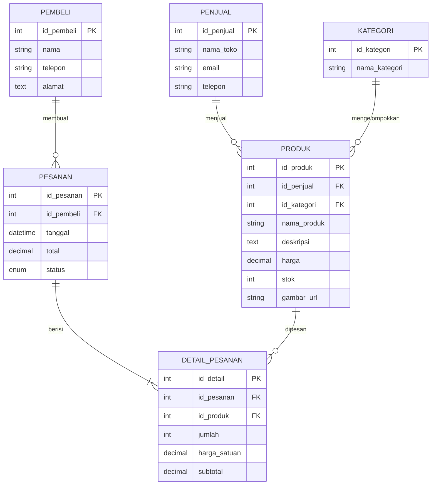
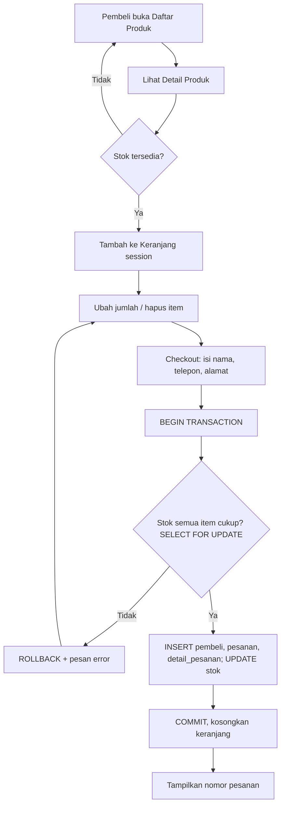

# Mini Marketplace (PHP Native + MySQLi + Bootstrap 5)

## A. Analisis & Perancangan

### a. Entitas
1. **Penjual** – pemilik toko yang menawarkan produk
2. **Kategori** – pengelompokan produk
3. **Produk** – barang yang dijual
4. **Pembeli** – pemesan (data diisi saat checkout)
5. **Pesanan** – header transaksi
6. **Detail_Pesanan** – item produk dalam satu pesanan

### b. Rancangan Database
| Tabel | Atribut (PK **tebal**, FK _miring_) |
|---|---|
| penjual | **id_penjual**, nama_toko, email, telepon |
| kategori | **id_kategori**, nama_kategori |
| produk | **id_produk**, _id_penjual_, _id_kategori_, nama_produk, deskripsi, harga, stok, gambar_url, created_at |
| pembeli | **id_pembeli**, nama, telepon, alamat |
| pesanan | **id_pesanan**, _id_pembeli_, tanggal, total, status |
| detail_pesanan | **id_detail**, _id_pesanan_, _id_produk_, jumlah, harga_satuan, subtotal |

Relasi: penjual 1–N produk; kategori 1–N produk; pembeli 1–N pesanan; pesanan 1–N detail_pesanan; produk 1–N detail_pesanan (pesanan–produk adalah N–M yang dipecah oleh detail_pesanan).

### c. ERD


### d. Alur Transaksi


### e. Mockup UI
**Daftar Produk**
```
+--------------------------------------------------+
| Mini Marketplace              Keranjang(2) Admin |
+--------------------------------------------------+
| [ Cari produk...                    ] [Cari]     |
| +----------+  +----------+  +----------+         |
| |  gambar  |  |  gambar  |  |  gambar  |         |
| | Nama     |  | Nama     |  | Nama     |         |
| | Rp xxx   |  | Rp xxx   |  | Rp xxx   |         |
| |[Detail][+]| |[Detail][+]| |[Detail][+]|        |
| +----------+  +----------+  +----------+         |
+--------------------------------------------------+
```
**Detail Produk**
```
+--------------------------------------------------+
| +-----------+  [Kategori]                        |
| |           |  Nama Produk                       |
| |  gambar   |  Penjual: Toko Demo                |
| |           |  Rp 250.000   Stok: 15             |
| +-----------+  Deskripsi ...                     |
|                [ Jumlah 1 ] [Tambah ke Keranjang]|
+--------------------------------------------------+
```
**Keranjang**
```
+--------------------------------------------------+
| Produk      | Harga | Jumlah [OK] | Subtotal |Hapus|
| Kopi 250g   | 45rb  |  [2]        | 90rb     | [x] |
| Kaos Polos  | 65rb  |  [1]        | 65rb     | [x] |
|                         Total:  Rp 155.000       |
| [Lanjut Belanja]                    [Checkout]   |
+--------------------------------------------------+
```

## B. Implementasi
File: `index.php` (daftar), `product.php` (detail), `cart.php`, `checkout.php` (transaksi), `admin.php` (CRUD produk + daftar pesanan), `database.sql`.
Keamanan: prepared statement MySQLi, `htmlspecialchars`, transaksi DB, kredensial di `config.php` yang di-ignore Git.

## C. Deployment & Publikasi

### InfinityFree
1. Daftar di infinityfree.com, buat akun hosting (subdomain gratis).
2. Control Panel (cPanel) → **MySQL Databases** → buat database; catat host (`sqlXXX.infinityfree.com`), user, password, nama DB.
3. Buka **phpMyAdmin** → pilih database → **Import** → `database.sql`.
4. Salin `config.sample.php` jadi `config.php`, isi kredensial dan `ADMIN_PASSWORD`.
5. Upload semua file (termasuk `config.php`) ke folder `htdocs` lewat File Manager/FTP.
6. Buka `http://namaanda.infinityfreeapp.com`.

### GitHub
```bash
git init
git add .
git status        # pastikan config.php TIDAK ada di daftar
git commit -m "Mini marketplace PHP native"
git branch -M main
git remote add origin https://github.com/USERNAME/marketplace.git
git push -u origin main
```

## Template Laporan
- URL demo: `http://........infinityfreeapp.com`
- URL GitHub: `https://github.com/USERNAME/marketplace`
- Screenshot: daftar produk, detail, keranjang, checkout sukses
- Screenshot phpMyAdmin: struktur 6 tabel, isi `pesanan` & `detail_pesanan`, stok `produk` berkurang
- Pengujian transaksi: (1) checkout normal → pesanan tersimpan & stok turun; (2) jumlah > stok → ditolak, rollback; (3) form kosong → ditolak
